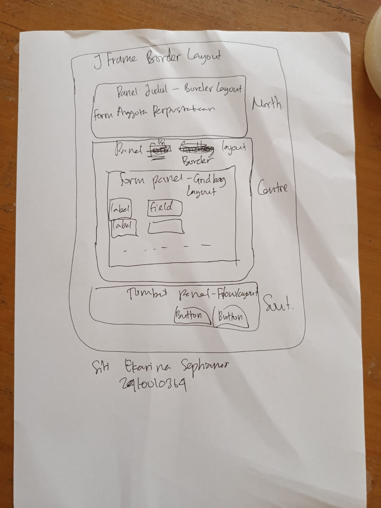
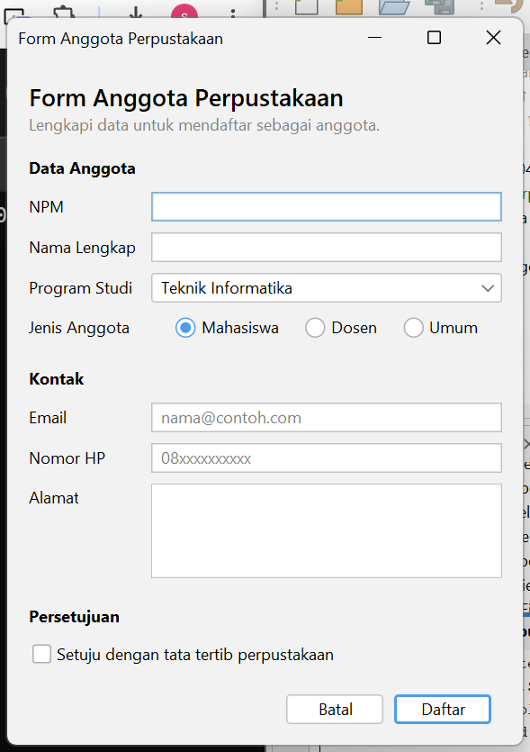
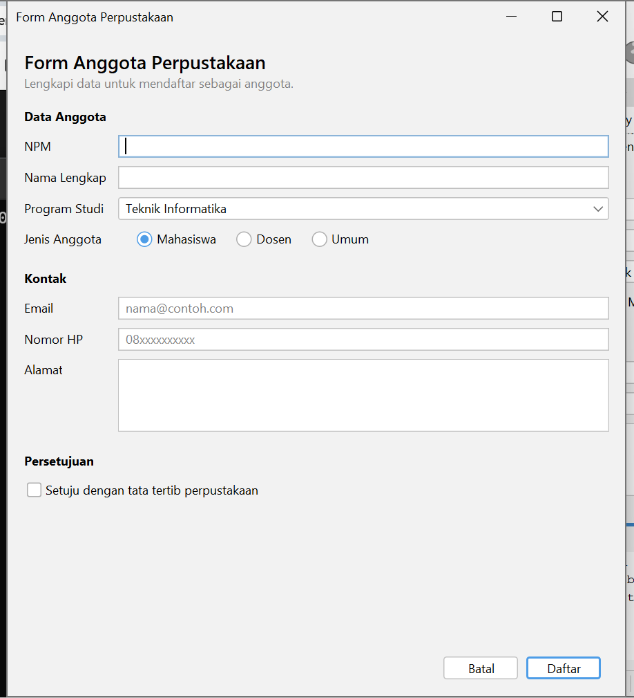
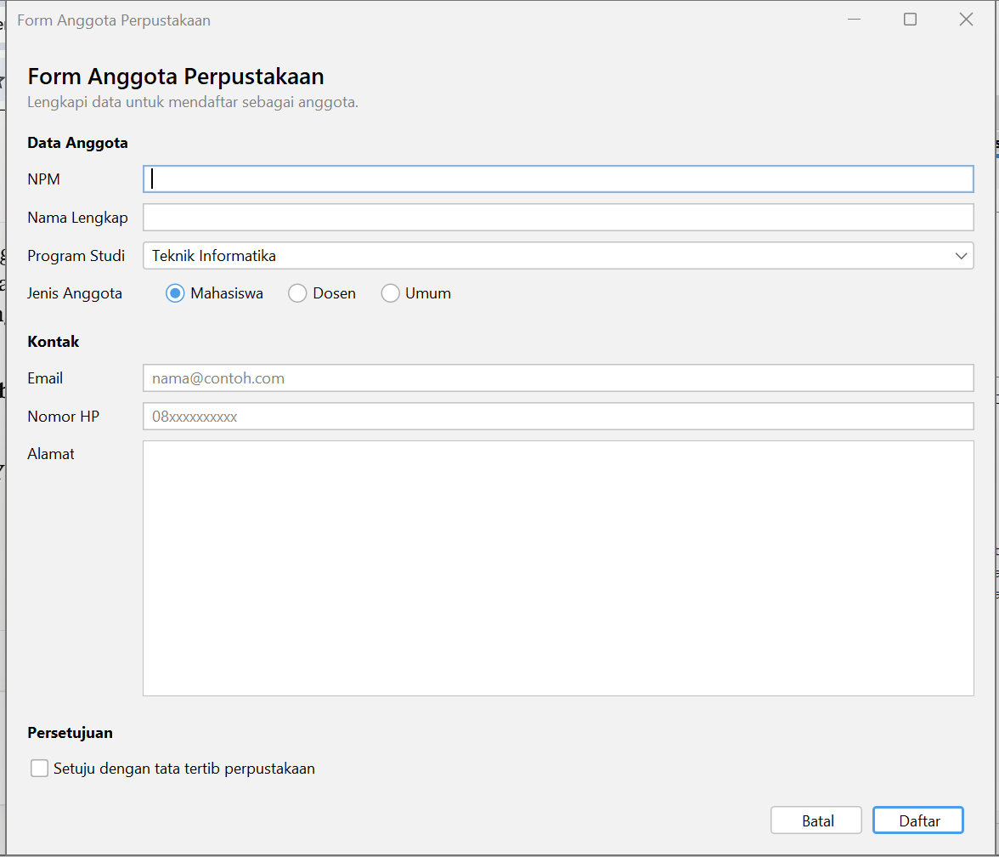
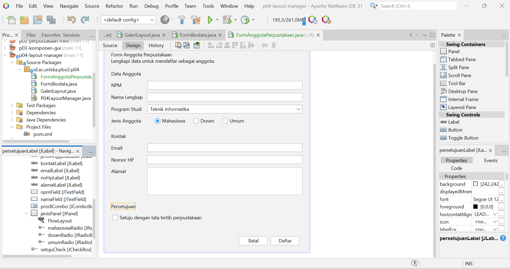

# P04: Layout Manager dan Desain Form

Mata kuliah: Pemrograman Berbasis Objek 2 (TIF1508), Pertemuan 4

|        |                                                                                      |
| ------ | ------------------------------------------------------------------------------------ |
| Nama   | Siti Ekarina Septianor                                                               |
| NPM    | 2410010364                                                                           |
| Kelas  | 4C                                                                                   |
| Proyek | `p04-layout-manager` (Group Id `id.ac.uniska.pbo2`, package `id.ac.uniska.pbo2.p04`) |

## Isi Proyek

| File                                       | Keterangan                                                                                |
| ------------------------------------------ | ----------------------------------------------------------------------------------------- |
| `GaleriLayout.java` dan `.form`            | Praktikum 2: galeri BorderLayout, FlowLayout, GridLayout, BoxLayout, dan layout bersarang |
| `FormBiodata.java` dan `.form`             | Praktikum 3 dan 4: form biodata dengan GridBagLayout                                      |
| `FormAnggotaPerpustakaan.java` dan `.form` | Studio Desain: form anggota perpustakaan                                                  |

---

## Studio Desain: Form Anggota Perpustakaan

### Tahap 1: Sketsa



### Tahap 2: Tabel Rancangan

| Bagian   | Panel                                           | Layout                                               |
| -------- | ----------------------------------------------- | ---------------------------------------------------- |
| Jendela  | JFrame                                          | BorderLayout                                         |
| Header   | `headerPanel` (North)                           | BoxLayout, Y Axis                                    |
| Isi form | `isiPanel` (Center), berisi `formPanel` (Center) | `isiPanel`: BorderLayout; `formPanel`: GridBagLayout |
| Tombol   | `tombolPanel` (South)                           | FlowLayout, Alignment Right                          |

Susunan panel (sesuai jendela Navigator):

```
JFrame (BorderLayout)
├── North  : headerPanel (BoxLayout, Y Axis)
│     ├── judulLabel
│     └── keteranganLabel
├── Center : isiPanel (BorderLayout)
│     └── Center: formPanel (GridBagLayout, Alamat diberi Weight Y 1.0)
│           ├── Data Anggota : NPM, Nama Lengkap, Program Studi, Jenis Anggota (jenisPanel: 3 RadioButton)
│           ├── Kontak       : Email, Nomor HP, Alamat
│           └── Persetujuan  : CheckBox tata tertib
└── South  : tombolPanel (FlowLayout, Right)
      ├── batalButton
      └── daftarButton (tombol default)
```

Alasan pemilihan layout:

- **BorderLayout** untuk kerangka jendela karena membagi header, isi, dan tombol ke wilayah North, Center, dan South.
- **BoxLayout (Y Axis)** untuk header karena judul dan keterangan disusun ke bawah.
- **GridBagLayout** untuk `formPanel` karena label dan isian berada di kolom dengan lebar berbeda (label menyempit, isian melebar).
- **FlowLayout (Right)** untuk tombol agar tombol rata kanan dengan jarak seragam.
- `formPanel` ditaruh di Center `isiPanel`, dan hanya area Alamat yang diberi Weight Y 1.0 (Fill Both). Saat jendela ditinggikan, baris lain tetap di atas dan hanya Alamat yang memanjang, sehingga tidak ada ruang kosong di antara isi form dan tombol.

### Tangkapan Layar

Form saat dijalankan, ukuran awal:



Form saat dilebarkan:



Form setelah diperbaiki sesuai saran teman:



Tab Design dengan susunan panel dan layout di jendela Navigator:



### Penerapan Prinsip Desain

- **Keselarasan:** semua label berada di kolom 0 dengan Anchor West dan semua isian di kolom 1 sehingga membentuk garis lurus dari atas ke bawah.
- **Kedekatan:** isian yang berkaitan dikelompokkan dengan judul bagian "Data Anggota", "Kontak", dan "Persetujuan".

---

## Jawaban Eksperimen Praktikum 2

**1. `flowPanel`: Alignment diubah menjadi Center, lalu jendela dikecilkan.**
Tombol menjadi rata tengah. Saat jendela dikecilkan, tombol yang tidak muat pindah ke baris berikutnya dan tiap barisnya tetap rata tengah. Baris di `initComponents()` yang ikut berubah adalah:

```java
flowPanel.setLayout(new java.awt.FlowLayout(java.awt.FlowLayout.LEFT, 8, 8));
```

menjadi

```java
flowPanel.setLayout(new java.awt.FlowLayout(java.awt.FlowLayout.CENTER, 8, 8));
```

**2. `gridPanel`: Rows menjadi 0 dan Columns menjadi 2.**
Terbentuk 5 baris. Jika Rows bernilai 0, GridLayout menghitung jumlah baris sendiri dari jumlah komponen dan jumlah kolom: 9 tombol dibagi 2 kolom dibulatkan ke atas menjadi 5 baris, dengan satu sel kosong di baris terakhir.

**3. `boxPanel`: `maximumSize` tombol diisi lebar 32767 dan tinggi sama dengan tinggi tombol.**
Tombol melebar memenuhi lebar panel dan semuanya sama lebar. Sebelumnya BoxLayout membatasi lebar tombol pada ukuran maksimum bawaannya, yaitu seukuran teks. Setelah Vertical Strut ditambahkan di antara tombol, muncul jarak tetap antar tombol sehingga tombol tidak menempel.

---

## Jawaban Eksperimen Praktikum 4

**1. Weight X `namaField` diubah menjadi 0.0, lalu jendela dilebarkan.**
Tidak ada perubahan, isian tetap melebar saat jendela dilebarkan. Karena Weight X dihitung per kolom dengan mengambil nilai terbesar, dan isian lain di kolom yang sama masih 1.0, kolom isian tetap mendapat sisa lebar. Weight X baru terlihat pengaruhnya jika semua isian dalam kolom itu bernilai 0.0.

**2. Direction `formPanel` di dalam `isiPanel` diubah dari North menjadi Center, lalu jendela ditinggikan.**
Dengan North, baris form tetap menempel di bagian atas saat jendela ditinggikan. Dengan Center, formPanel ikut ditarik memenuhi tinggi panel sehingga baris-barisnya bergeser ke tengah dan muncul ruang kosong di atas dan bawah. Itulah alasan formPanel dibungkus isiPanel dan ditaruh di North pada rancangan dasar FormBiodata.

**3. Baris `setMinimumSize(getSize())` dihapus, lalu jendela dikecilkan sekecil mungkin.**
Jendela bisa dikecilkan sampai sangat kecil dan tampilan rusak. Bagian yang terpotong lebih dulu adalah isi form (alamat dan isian di bagian bawah), lalu panel tombol, dan terakhir header. Hal ini karena BorderLayout memberi North dan South ukuran yang dibutuhkan, sedangkan Center hanya mendapat sisanya. setMinimumSize mencegah hal ini dengan membatasi ukuran terkecil jendela.

---

## Saran dari Teman (Tahap 4)

Teman pemeriksa: Selvia Melani Putri

Saran perbaikan: Form nya sudah lumayan rapi tapi saat jendela ditinggikan, isi form tetap di atas dan muncul ruang kosong sebelum tombol. Bisa beri weight Y 1.0 dan fill BOTH pada kolom alamat, lalu pindahkan formPanel ke CENTER agar Alamat ikut memanjang.

Tindak lanjut: saran diterapkan. `formPanel` dipindah dari North ke Center, dan `alamatPane` diberi Fill Both dengan Weight Y 1.0. Hasilnya, saat jendela ditinggikan hanya Alamat yang memanjang dan baris lainnya tetap di atas (lihat tangkapan layar "Form setelah diperbaiki sesuai saran teman").

---

## Pertanyaan Refleksi

**1. Mengapa Null Layout dan Absolute Layout sebaiknya dihindari?**
Keduanya memakai posisi piksel yang tetap sehingga tampilan tidak menyesuaikan ukuran jendela dan teks dapat terpotong pada skala layar berbeda. Absolute Layout juga membutuhkan library tambahan NetBeans sehingga aplikasi sulit dijalankan di komputer lain.

**2. Perbedaan perilaku FlowLayout dan GridLayout saat jendela dilebarkan.**
FlowLayout mempertahankan ukuran asli komponen dan menyusunnya berderet, pindah baris jika tidak muat. GridLayout membagi ruang menjadi sel yang sama besar sehingga semua komponen ikut melebar.

**3. Fungsi Weight X dan Fill pada GridBagLayout.**
Weight X menentukan pembagian sisa lebar ke kolom (1.0 untuk isian agar melebar, 0.0 untuk label). Fill menentukan apakah komponen memenuhi selnya (Horizontal agar kotak isian memanjang mengikuti lebar kolom).

**4. Mengapa `formPanel` dibungkus `isiPanel` dan diletakkan di North?**
Pada rancangan dasar di modul (FormBiodata), `formPanel` ditaruh di North `isiPanel` agar baris form tetap rapat di atas saat jendela ditinggikan. Jika diletakkan di Center tanpa Weight Y, GridBagLayout membagi tinggi tambahan ke seluruh isi sehingga baris form bergeser ke tengah (hasil Eksperimen 2). Pada FormAnggotaPerpustakaan saya meletakkan `formPanel` di Center, tetapi memberi Weight Y 1.0 hanya pada area Alamat, sehingga baris lain tetap di atas dan hanya Alamat yang memanjang.

**5. Dua prinsip desain yang diterapkan.**
Keselarasan (label di kolom 0 dan isian di kolom 1 membentuk garis lurus) dan kedekatan (isian dikelompokkan dengan judul bagian "Data Anggota", "Kontak", dan "Persetujuan").

---

## Deklarasi Penggunaan AI

Alat yang digunakan: Claude (Anthropic).

Keperluan: membantu menjelaskan konsep layout manager dan constraint GridBagLayout, mengecek kode hasil NetBeans terhadap modul, memberi saran perbaikan form, membantu memeriksa form teman pada Tahap 4, serta membantu menyusun draf README ini. Pembuatan form di NetBeans, pengujian tampilan, dan pengamatan hasil eksperimen saya lakukan sendiri.
