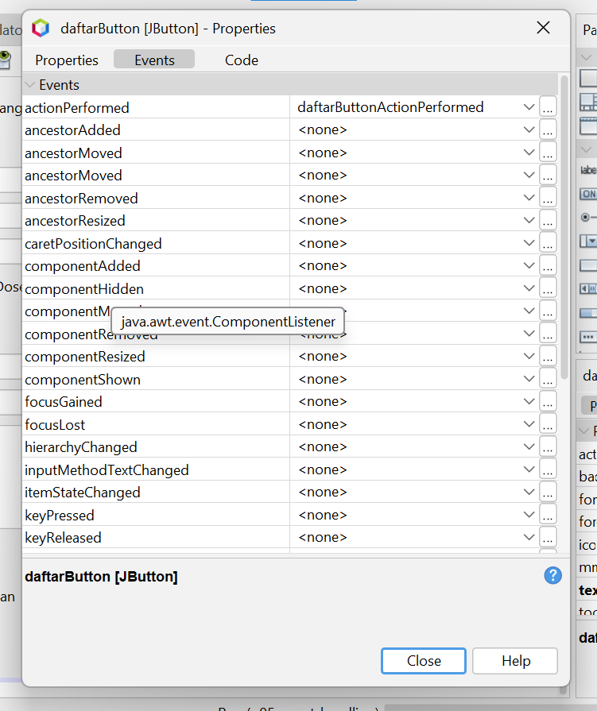
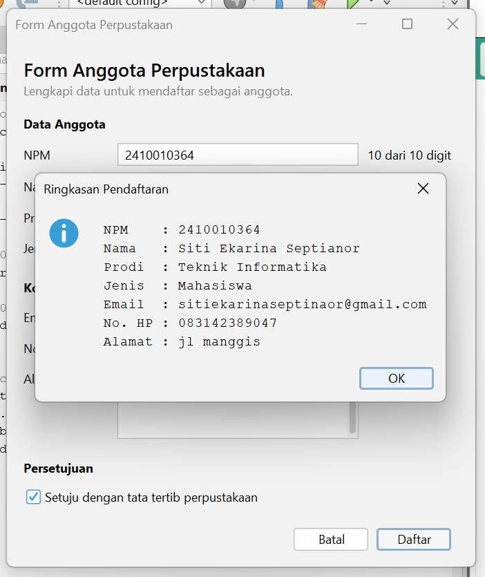
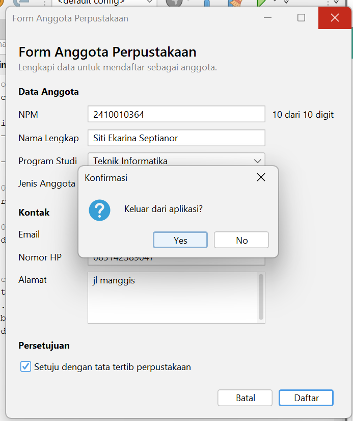

# Tugas 5 - Event Handling

|                 |                                                     |
| --------------- | --------------------------------------------------- |
| **Mata Kuliah** | Pemrograman Berbasis Objek 2 (TIF1508)              |
| **Pertemuan**   | 5 - Event Handling                                  |
| **Nama**        | Siti Ekarina Septianor                              |
| **NIM**         | 2410010364                                          |
| **Kelas**       | 5C Reg BJM                                          |
| **Proyek**      | `p05-event-handling` (repository `pbo2-2410010364`) |

---

## 1. Tabel Pengamatan Praktikum 2 (PengamatEvent)

| No  | Tindakan                                  | Event yang tercatat                                                                            |
| --- | ----------------------------------------- | ---------------------------------------------------------------------------------------------- |
| 1   | Arahkan kursor ke tombol, lalu jauhkan    | MouseEvent (kursor masuk ke tombol), MouseEvent (kursor keluar dari tombol)                    |
| 2   | Klik tombol Klik saya                     | MouseEvent (kursor masuk ke tombol), ActionEvent (tombol diklik)                               |
| 3   | Centang lalu hapus centang Aktifkan fitur | ItemEvent (kotak dicentang), ItemEvent (centang dihapus)                                       |
| 4   | Ganti pilihan dari Pagi menjadi Malam     | ItemEvent (memilih Malam)                                                                      |
| 5   | Klik isian, lalu ketik kata "abc"         | FocusEvent (isian mendapat fokus), KeyEvent (a), KeyEvent (b), KeyEvent (c)                    |
| 6   | Klik tombol setelah mengetik di isian     | MouseEvent (masuk ke tombol), FocusEvent (isian kehilangan fokus), ActionEvent (tombol diklik) |

---

## 2. Jawaban Eksperimen Praktikum 3 (Konversi Suhu)

**Eksperimen 1.** Setelah pemeriksaan `if (evt.getStateChange() == ItemEvent.SELECTED)` dihapus, pesan `item berubah` tercetak **2 kali** setiap pilihan diganti (misalnya dari Fahrenheit ke Kelvin, atau pilihan lainnya).
Penjelasan: `itemStateChanged` pada Combo Box dipanggil dua kali untuk satu kali penggantian pilihan, yaitu sekali untuk pilihan lama yang dilepas (`DESELECTED`) dan sekali untuk pilihan baru yang dipilih (`SELECTED`). Tanpa pemeriksaan `SELECTED`, kedua pemanggilan menjalankan aksi, sehingga `konversi()` ikut berjalan dua kali. Pemeriksaan itu membuat aksi hanya berjalan satu kali, untuk pilihan yang baru.

**Eksperimen 2.** Hasil terlambat satu karakter. Saat mengetik `123`, setelah mengetik `1` belum ada hasil, setelah `12` yang tampil 33,80 F (hasil untuk 1 °C), dan setelah `123` yang tampil 53,60 F (hasil untuk 12 °C), padahal seharusnya 253,40 F.
Penjelasan: `keyPressed` dipicu saat tombol ditekan, sebelum karakter masuk ke Text Field, sehingga `getText()` di dalam `konversi()` masih membaca isi yang lama. `keyReleased` dipicu setelah tombol dilepas, ketika karakter sudah masuk, sehingga hasilnya langsung sesuai isian.

**Eksperimen 3.** Setelah blok `try` dan `catch` dihapus, mengetik huruf `a` pada isian memunculkan pesan error di jendela Output:
`Exception in thread "AWT-EventQueue-0" java.lang.NumberFormatException: For input string: "a"`
dengan jejak `at java.base/java.lang.Double.parseDouble(Double.java:971)`, lalu `at id.ac.uniska.pbo2.p05.KonversiSuhu.konversi(KonversiSuhu.java:113)`, dan `at id.ac.uniska.pbo2.p05.KonversiSuhu.celsiusFieldKeyReleased(KonversiSuhu.java:103)`. Pesan yang sama muncul lagi ketika tombol Konversi diklik dengan isian `a`, kali ini lewat `konversiButtonActionPerformed`. Label hasil tetap kosong dan tidak menampilkan pesan apa pun.
Penjelasan: `Double.parseDouble()` melempar `NumberFormatException` karena teks "a" bukan angka. Tanpa `try-catch`, exception tidak ditangani, sehingga method `konversi()` berhenti di tengah jalan sebelum `hasilLabel.setText(...)` dijalankan. Akibatnya label tidak diperbarui dan jejak error tercetak di Output setiap kali event dipicu. Aplikasi tetap berjalan, tetapi pengguna tidak mendapat umpan balik apa pun. Dengan `try-catch`, error ditangkap dan label menampilkan "Masukkan angka yang valid".

---

## 3. Jawaban Eksperimen Praktikum 4 (Kalkulator Sederhana)

**Eksperimen 1.** Setelah event `actionPerformed` untuk `kaliButton` dibuat lewat Events tanpa menghapus lambda di konstruktor, dan `System.out.println("kali");` ditambahkan di kedua tempat, pesan `kali` tercetak **2 kali** setiap tombol `x` diklik satu kali.
Penjelasan: `kaliButton` memiliki dua listener, yaitu `ActionListener` dari event handler GUI Builder (`kaliButtonActionPerformed`) dan `ActionListener` dari lambda di konstruktor. Satu klik memicu keduanya sehingga aksi berjalan dua kali. Satu tombol sebaiknya hanya memakai satu cara agar aksi tidak ganda, hasil tidak membingungkan, dan kode lebih mudah dipelihara.

**Eksperimen 2.** Menambahkan tombol `%` untuk sisa bagi (modulus). Hasil uji: `12 % 5` menampilkan `Hasil: 12 % 5 = 2`.

- **Tab Design:**
  1. Menambahkan Button baru ke `operatorPanel` dengan variable name `modButton` dan teks `%`.
  2. Mengubah Columns Grid Layout `operatorPanel` dari 4 menjadi 5 agar lima tombol sebaris.
  3. Membuat event `actionPerformed` untuk `modButton` lewat Events, Action, actionPerformed.
- **Tab Source:**
  1. Mengisi event handler `modButtonActionPerformed` dengan `hitung('%');`.
  2. Menambahkan `case '%' -> a % b;` pada `switch` di method `hitung`, sebelum `default`. Tanpa baris ini, `%` jatuh ke `default` dan dihitung sebagai pembagian.
  3. Menambahkan `%` pada pemeriksaan pembagi nol: `if ((operator == '/' || operator == '%') && b == 0)`.

**Eksperimen 3.** Setelah tombol Hapus ditekan, kursor langsung berkedip di isian pertama (`angka1Field`).
Penjelasan: method `hapus` memanggil `angka1Field.requestFocusInWindow()` di baris terakhir, yang meminta agar fokus keyboard dipindahkan ke isian pertama. Saat tombol Hapus diklik, fokus berpindah ke tombol itu. Tanpa baris tersebut, kursor tidak akan berada di isian dan pengguna harus mengklik isian terlebih dahulu sebelum mengetik angka berikutnya. Dengan baris ini, pengguna bisa langsung mengisi angka baru.

---

## 4. Peta Event FormAnggotaPerpustakaan

| Komponen                    | Menu Events               | Aksi                                                             |
| --------------------------- | ------------------------- | ---------------------------------------------------------------- |
| Kotak centang `setujuCheck` | Item: `itemStateChanged`  | Tombol Daftar hanya aktif jika dicentang                         |
| Tombol `batalButton`        | Action: `actionPerformed` | Kosongkan semua isian dan kembalikan fokus ke NPM                |
| Tombol `daftarButton`       | Action: `actionPerformed` | Tampilkan ringkasan data dengan `JOptionPane`                    |
| Isian `npmField`            | Key: `keyReleased`        | Label kecil menampilkan jumlah digit, misalnya "8 dari 10 digit" |
| Form (JFrame di Navigator)  | Window: `windowClosing`   | Minta konfirmasi sebelum aplikasi ditutup                        |

Catatan: `defaultCloseOperation` form diubah menjadi `DO_NOTHING` dan properti `enabled` tombol Daftar dihilangkan centangnya.

---

## 5. Tangkapan Layar

### Jendela Properties bagian Events untuk tombol Daftar

### Dialog ringkasan

### Dialog konfirmasi keluar

---

## 6. Jawaban Pertanyaan Refleksi

1. **Peran sumber event, object event, dan listener**
   Contohnya di `PengamatEvent`. Sumber event itu `klikButton`, karena di situ klik terjadi. Object event itu `ActionEvent evt`, isinya info tentang kejadian yang dikirim ke method. Listener itu `ActionListener` yang didaftarkan lewat `klikButton.addActionListener(this::klikButtonActionPerformed)`. Listener inilah yang menjalankan `klikButtonActionPerformed` waktu tombol diklik.

2. **Kenapa KeyListener tidak bisa pakai lambda**
   Lambda cuma bisa dipakai kalau interface-nya punya satu method abstract. `KeyListener` punya tiga method (`keyPressed`, `keyReleased`, `keyTyped`) dan semuanya wajib ditulis. NetBeans mengatasinya pakai `KeyAdapter`, yaitu kelas yang sudah menyediakan isi kosong untuk semua method. Jadi waktu saya pilih `keyReleased`, cuma method itu yang perlu ditulis. Ini kelihatan di `celsiusField.addKeyListener(new java.awt.event.KeyAdapter() {...})`.

3. **Untungnya memisahkan KonverterSuhu dari form KonversiSuhu**
   Rumus konversi jadi tidak tercampur dengan tampilan. Kelasnya bisa dipakai lagi di form lain dan bisa dites tanpa GUI (nanti di Pertemuan 13). Kalau rumusnya diubah, kode form tidak perlu disentuh. Kode form juga jadi lebih pendek karena tugasnya cuma membaca isian, memanggil `KonverterSuhu`, lalu menampilkan hasil.

4. **Kenapa itemStateChanged perlu cek SELECTED**
   Combo Box memicu `itemStateChanged` dua kali tiap pilihan diganti: sekali untuk pilihan lama (`DESELECTED`) dan sekali untuk pilihan baru (`SELECTED`). Waktu pengecekan dihapus di eksperimen, pesan memang tercetak 2 kali. Dengan `evt.getStateChange() == ItemEvent.SELECTED`, aksinya cuma jalan sekali, yaitu untuk pilihan yang baru.

5. **Kapan pakai event handler GUI Builder, lambda, atau method reference**
   - **Event handler GUI Builder:** cara utama di JFrame Form dan tersimpan di file `.form`. Saya pakai untuk tombol `+`, `-`, `/`, `%` di kalkulator dan semua event di `FormAnggotaPerpustakaan`.
   - **Lambda:** untuk aksi singkat yang ditulis di konstruktor setelah `initComponents()`. Contohnya `kaliButton.addActionListener(e -> hitung('x'))`.
   - **Method reference:** kalau aksinya sudah ada sebagai method sendiri. Contohnya `hapusButton.addActionListener(this::hapus)`.

   Satu tombol sebaiknya cukup satu cara saja. Waktu `kaliButton` saya beri dua cara sekaligus, aksinya jalan dua kali.

## 7. Deklarasi Penggunaan AI

Alat yang dipakai: Claude (Anthropic).
Keperluan: membantu memahami konsep event handling, mengecek dan memperbaiki error kompilasi, membantu menyusun kode `FormAnggotaPerpustakaan`, serta membantu menyusun dan merapikan README (termasuk draf jawaban eksperimen dan refleksi). Seluruh kode saya jalankan dan uji sendiri, dan jawaban eksperimen saya sesuaikan dengan hasil percobaan saya sendiri.
