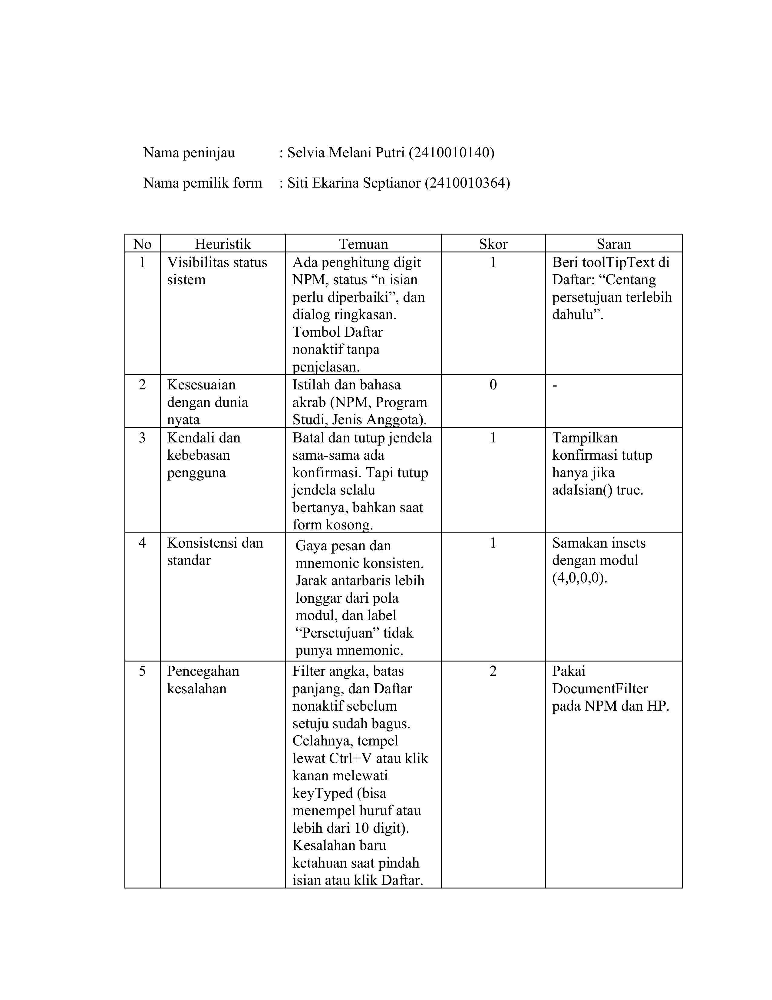
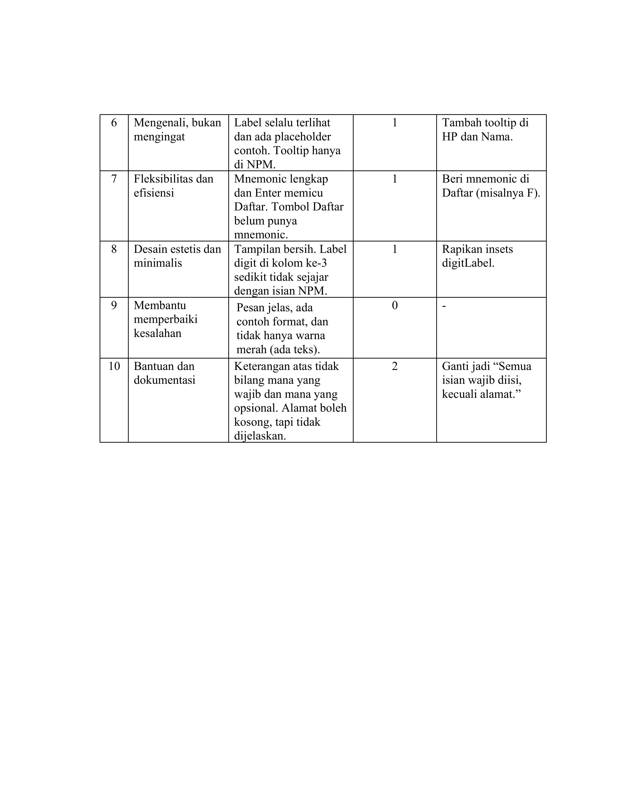
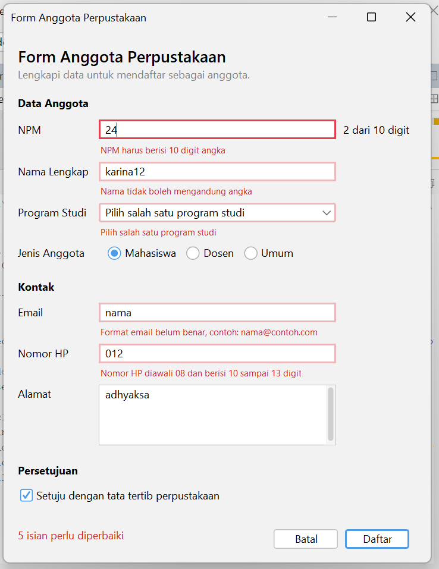
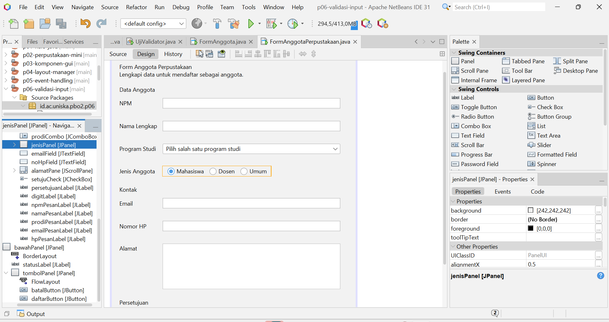

# P06 - Validasi Input dan Kegunaan

| Identitas   | Keterangan                             |
| ----------- | -------------------------------------- |
| Mata Kuliah | Pemrograman Berbasis Objek 2 (TIF1508) |
| Pertemuan   | 6 - Validasi Input dan Kegunaan        |
| Nama        | Siti Ekarina Septianor                 |
| NPM         | 2410010364                             |
| Kelas       | 5C REG BJM                             |

## Isi Proyek

Proyek Maven `p06-validasi-input` (package `id.ac.uniska.pbo2.p06`):

| File                | Keterangan                                                              |
| ------------------- | ----------------------------------------------------------------------- |
| `Validator.java`    | Aturan validasi NPM, nama, email, dan nomor HP (terpisah dari tampilan) |
| `UjiValidator.java` | Pengujian aturan Validator lewat console                                |
| `FormAnggota.java`  | JFrame Form `FormAnggotaPerpustakaan` yang sudah divalidasi             |
| `FormAnggota.form`  | File desain GUI Builder                                                 |

---

## 1. Lembar Peer Review

Peninjau: Selvia Melani Putri (2410010140)
Pemilik form: Siti Ekarina Septianor (2410010364)

---

## 2. Tabel Temuan, Perbaikan, dan Commit

## 2. Tabel Temuan, Perbaikan, dan Commit

| No. | Heuristik Nielsen                                     | Temuan dari Teman                                                                                    | Perbaikan yang Dilakukan                                                                                           | Commit        |
| --- | ----------------------------------------------------- | ---------------------------------------------------------------------------------------------------- | ------------------------------------------------------------------------------------------------------------------ | ------------- |
| 1   | Visibilitas status sistem                             | Tombol Daftar nonaktif tanpa penjelasan. (Skor 1)                                                    | Menambahkan tooltip pada tombol Daftar agar pengguna mengetahui bahwa persetujuan harus dicentang terlebih dahulu. | `hash-commit` |
| 2   | Kesesuaian dengan dunia nyata                         | Istilah NPM, Program Studi, dan Jenis Anggota sudah familiar. (Skor 0)                               | Tidak memerlukan perbaikan.                                                                                        | -             |
| 3   | Kendali dan kebebasan pengguna                        | Form selalu meminta konfirmasi saat ditutup, meskipun belum ada data yang diisi. (Skor 1)            | Menambahkan pemeriksaan `adaIsian()` agar konfirmasi hanya muncul jika form berisi data.                           | `hash-commit` |
| 4   | Konsistensi dan standar                               | Jarak antarelemen belum sepenuhnya konsisten dan label Persetujuan belum memiliki mnemonic. (Skor 1) | Menyesuaikan jarak komponen dan menambahkan mnemonic pada label Persetujuan jika diperlukan.                       | `hash-commit` |
| 5   | Pencegahan kesalahan                                  | Input NPM masih dapat menerima karakter tidak valid melalui paste. (Skor 2)                          | Menambahkan validasi input yang juga memeriksa karakter hasil paste, bukan hanya ketikan langsung.                 | `hash-commit` |
| 6   | Pengenalan daripada mengingat                         | Petunjuk pada kolom Nama dan Nomor HP masih kurang. (Skor 1)                                         | Menambahkan tooltip berisi petunjuk pengisian pada kolom Nama dan Nomor HP.                                        | `hash-commit` |
| 7   | Fleksibilitas dan efisiensi                           | Tombol Daftar belum memiliki mnemonic. (Skor 1)                                                      | Menambahkan mnemonic pada tombol Daftar agar dapat diakses melalui keyboard.                                       | `hash-commit` |
| 8   | Desain estetis dan minimalis                          | Posisi label penghitung digit NPM sedikit kurang sejajar. (Skor 1)                                   | Menyesuaikan posisi dan jarak label penghitung digit agar lebih rapi.                                              | `hash-commit` |
| 9   | Membantu pengguna mengenali dan memperbaiki kesalahan | Pesan kesalahan sudah cukup jelas dan disertai petunjuk perbaikan. (Skor 0)                          | Tidak memerlukan perbaikan.                                                                                        | -             |
| 10  | Bantuan dan dokumentasi                               | Keterangan awal belum menjelaskan bahwa alamat merupakan isian opsional. (Skor 2)                    | Memperjelas petunjuk pengisian menjadi "Semua isian wajib diisi, kecuali alamat."                                  | `hash-commit` |

> Isi hash commit dari `git log --oneline`. Temuan skor 3 dan 4 wajib diperbaiki dan bisa ditelusuri ke commit.

---

## 3. Tangkapan Layar Form dengan Pesan Kesalahan

## 4. Tangkapan Layar Jendela Navigator

Memperlihatkan label pesan (`npmPesanLabel`, `namaPesanLabel`, `prodiPesanLabel`, `emailPesanLabel`, `hpPesanLabel`).

---

## 5. Jawaban Eksperimen Praktikum 4

1. **Ketik huruf pada isian NPM.** Huruf tidak muncul di isian. Penyebabnya baris `evt.consume()` di dalam `if (!Character.isDigit(evt.getKeyChar()) || penuh)` pada `npmFieldKeyTyped`, yang membatalkan karakter bukan angka.
2. **Isi email `siti@`, lalu Tab.** Pesan kesalahan muncul saat pengguna berpindah dari isian email (event `focusLost`), bukan saat mengetik.
3. **Klik isian Nama tanpa mengetik, lalu Tab.** Tidak ada pesan kesalahan karena `namaFieldFocusLost` hanya memeriksa isian yang tidak kosong (`!isBlank()`). Isian kosong baru diperiksa saat tombol Daftar diklik.
4. **Centang persetujuan, lalu klik Daftar dengan form kosong.** Semua kesalahan ditampilkan sekaligus dan fokus diarahkan ke isian pertama yang salah, yaitu `npmField`.
5. **Tekan Alt + N.** Fokus berpindah ke `namaField`. Properti yang mengaturnya adalah `displayedMnemonic` (`N`) pada `namaLabel`, dihubungkan ke isian lewat properti `labelFor`.
6. **Isi beberapa isian, klik Batal, pilih No.** Data tetap ada karena `batal()` langsung `return` jika jawaban bukan `YES_OPTION`.

---

## 6. Refleksi

1. Mengapa aturan validasi dipisahkan ke kelas Validator, bukan ditulis langsung di event handler?
   Supaya aturan tidak bercampur dengan tampilan. Aturan yang sama bisa dipakai ulang di banyak tempat, perubahannya cukup dilakukan di satu tempat, dan bisa diuji tanpa GUI lewat UjiValidator (nanti dengan JUnit di Pertemuan 13). Kode di event handler juga lebih pendek dan mudah dibaca.

2. Mengapa isian kosong tidak langsung ditandai merah saat pengguna hanya melewatinya?
   Karena pengguna belum sempat mengisi, jadi belum ada kesalahan. Kalau langsung merah, pengguna merasa disalahkan sebelum mencoba, dan tampilan jadi penuh peringatan. Isian kosong baru diperiksa saat tombol Daftar diklik, dan di situ semua kesalahan ditampilkan sekaligus.

3. Tiga heuristik Nielsen yang diterapkan beserta buktinya

Pencegahan kesalahan (no. 5): npmFieldKeyTyped dan hpFieldKeyTyped menolak huruf dengan evt.consume(), dan NPM dibatasi 10 digit. Tombol Daftar nonaktif sampai persetujuan dicentang.
Membantu memperbaiki kesalahan (no. 9): pesan di label bawah isian menjelaskan masalah dan solusinya, misalnya “Format email belum benar, contoh: nama@contoh.com”.
Kendali dan kebebasan pengguna (no. 3): tombol Batal meminta konfirmasi “Data yang sudah diisi akan dihapus. Lanjutkan?”, dan pilihan No membatalkan penghapusan.

Cadangan kalau mau ganti satu: Visibilitas status sistem (no. 1), buktinya statusLabel yang menampilkan “N isian perlu diperbaiki”.

4. Mengapa pesan kesalahan tidak boleh hanya berupa warna merah?
   Sebagian pengguna buta warna dan tidak bisa membedakan merah dari warna lain. Pembaca layar juga tidak membacakan warna. Karena itu kesalahan harus disertai teks yang menyebut isian mana yang salah dan cara memperbaikinya. Di form ini, garis merah selalu disertai pesan teks di bawah isian.

5. belummm

## 7. Deklarasi Penggunaan AI

Saya menggunakan Claude (Anthropic) sebagai alat bantu untuk memeriksa kode `FormAnggota`, `Validator`, dan `UjiValidator` terhadap isi modul, memahami konsep mnemonic dan `labelFor`, serta mempelajari cara mengatur properti komponen melalui jendela Properties. AI juga membantu menyusun template README ini. Seluruh kode tetap saya jalankan dan uji sendiri, sedangkan eksperimen praktikum saya lakukan langsung pada form.

---

## Cara Menjalankan

1. Buka proyek `p06-validasi-input` di Apache NetBeans (JDK 21 atau lebih baru).
2. Klik kanan proyek, pilih **Build**.
3. Jalankan `UjiValidator` (Run File) untuk menguji aturan validasi.
4. Jalankan `FormAnggota` (Run File) untuk mencoba form.
