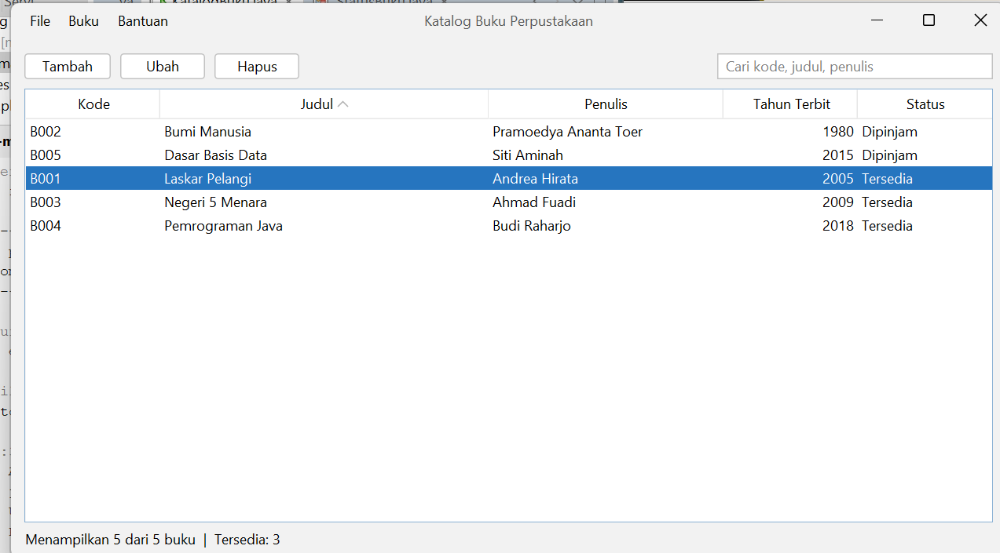
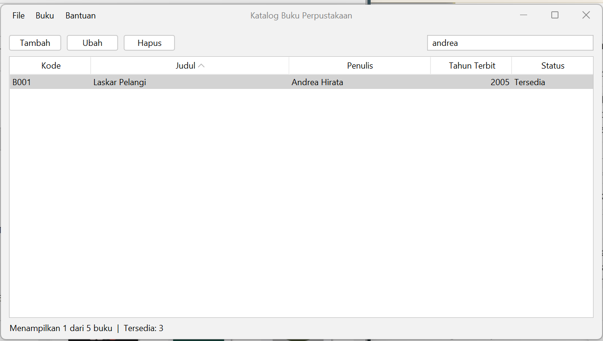
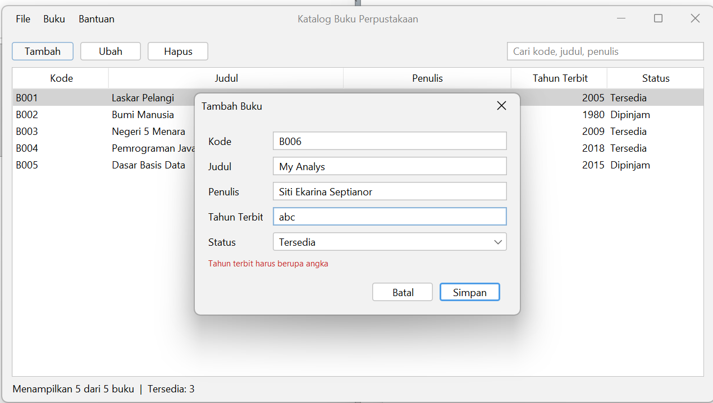
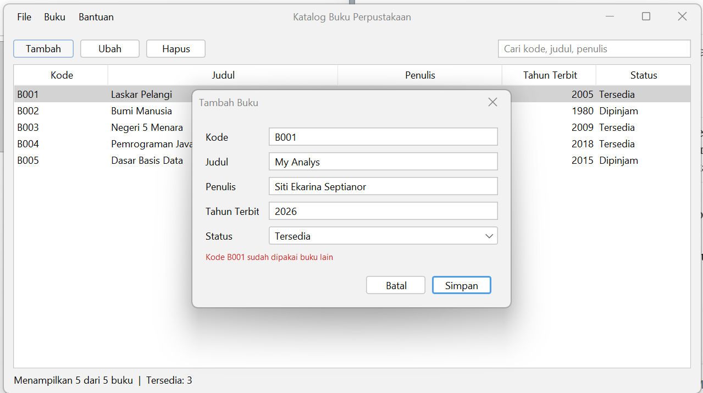
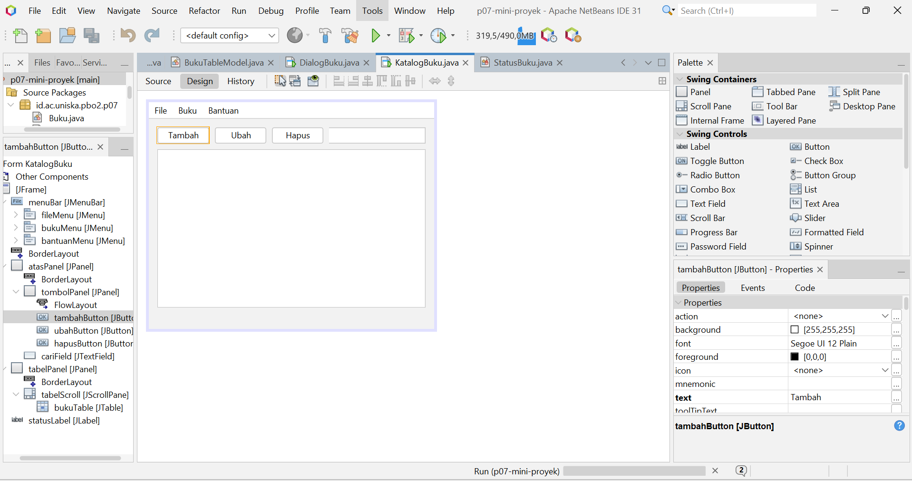

# Tugas 7 - Tabel, Menu, dan Mini Proyek

|                 |                                                                                      |
| --------------- | ------------------------------------------------------------------------------------ |
| **Mata Kuliah** | Pemrograman Berbasis Objek 2 (TIF1508)                                               |
| **Pertemuan**   | 7 - Tabel, Menu, dan Mini Proyek                                                     |
| **Nama**        | Siti Ekarina Septianor                                                               |
| **NIM**         | 2410010364                                                                           |
| **Kelas**       | 5C Reg BJM                                                                           |
| **Proyek**      | `p07-tabel-dan-menu` dan `p07-mini-proyek` (repository `pbo2-2410010364`)            |
| **Video Demo**  | https://drive.google.com/drive/folders/16Cen_oJiUaXVk4DpTu1DMM2VxwNQFsjG?usp=sharing |

---

## 1. Tentang Mini Proyek: Katalog Buku Perpustakaan

Aplikasi desktop Swing dengan FlatLaf untuk mengelola katalog buku: menampilkan buku di tabel, menambah, mengubah, menghapus, mencari, dan melihat jumlah buku yang tersedia.

**Cara menjalankan:** buka proyek `p07-mini-proyek` di Apache NetBeans (JDK sesuai `pom.xml`), klik kanan proyek lalu Clean and Build, kemudian klik kanan `KatalogBuku.java` dan pilih Run File.

### Struktur kelas

| Kelas            | Jenis                | Fungsi                                                                   |
| ---------------- | -------------------- | ------------------------------------------------------------------------ |
| `Buku`           | record               | Data satu buku: kode, judul, penulis, tahun, status                      |
| `StatusBuku`     | enum                 | `TERSEDIA` dan `DIPINJAM`; `toString()` menghasilkan teks di tabel/combo |
| `BukuTableModel` | `AbstractTableModel` | Menghubungkan `List<Buku>` dengan `JTable`; berisi `fireTableRows...`    |
| `DialogBuku`     | JDialog Form (modal) | Form tambah dan ubah, beserta validasi                                   |
| `KatalogBuku`    | JFrame Form          | Jendela utama: tombol, tabel, pencarian, menu, label status              |

File `.form`: `KatalogBuku.form` dan `DialogBuku.form`.

### Fitur sesuai ketentuan modul

| No  | Fitur           | Penerapan                                                                                        |
| --- | --------------- | ------------------------------------------------------------------------------------------------ |
| 1   | Tabel buku      | 5 kolom (kode, judul, penulis, tahun terbit, status) dengan `BukuTableModel`                     |
| 2   | Data contoh     | 5 buku diisi oleh `isiContoh()` saat aplikasi dibuka                                             |
| 3   | Tambah dan ubah | Lewat `DialogBuku` (modal). Kode dan judul wajib, tahun berupa angka 1900 sampai tahun sekarang  |
| 4   | Hapus           | Dengan konfirmasi `JOptionPane`; nomor baris diubah dengan `convertRowIndexToModel`              |
| 5   | Menu            | Menu Bar di GUI Builder: File, Buku, Bantuan, dengan mnemonic dan accelerator Ctrl               |
| 6   | Pencarian       | `cariField` menyaring kode, judul, dan penulis memakai `TableRowSorter` dan `RowFilter`          |
| 7   | Status          | Label "Menampilkan X dari Y buku \| Tersedia: Z"                                                 |
| 8   | Tampilan        | JFrame Form dan JDialog Form dengan `.form`, FlatLaf, tombol Ubah dan Hapus aktif sesuai pilihan |

Tambahan di luar ketentuan: kode buku tidak boleh sama dengan buku lain (`kodeSudahAda`), dan klik dua kali pada baris membuka dialog Ubah.

---

## 2. Peta Event

### Jendela utama `KatalogBuku`

| Komponen                     | Menu Events                              | Aksi                                                          |
| ---------------------------- | ---------------------------------------- | ------------------------------------------------------------- |
| `tambahButton`, `tambahItem` | Action: `actionPerformed`                | `tambah()`: buka `DialogBuku` kosong, lalu tambahkan ke model |
| `ubahButton`, `ubahItem`     | Action: `actionPerformed`                | `ubah()`: buka `DialogBuku` berisi data baris terpilih        |
| `hapusButton`, `hapusItem`   | Action: `actionPerformed`                | `hapus()`: konfirmasi, lalu hapus dari model                  |
| `cariField`                  | Key: `keyReleased`                       | `saring()`: saring tabel berdasarkan kode, judul, penulis     |
| `bukuTable`                  | Mouse: `mouseClicked`                    | Klik dua kali memanggil `ubah()`                              |
| `keluarItem`                 | Action: `actionPerformed`                | `dispose()`: menutup jendela                                  |
| `tentangItem`                | Action: `actionPerformed`                | `JOptionPane` berisi keterangan aplikasi                      |
| Pilihan baris `bukuTable`    | `ListSelectionListener` (di konstruktor) | `perbaruiTombol()`: aktifkan atau nonaktifkan Ubah dan Hapus  |

### Dialog `DialogBuku`

| Komponen       | Menu Events               | Aksi                                                    |
| -------------- | ------------------------- | ------------------------------------------------------- |
| `batalButton`  | Action: `actionPerformed` | `dispose()`: tutup dialog, `hasil` tetap `null`         |
| `simpanButton` | Action: `actionPerformed` | `simpan()`: validasi, lalu buat `Buku` dan tutup dialog |

### Menu Bar

| Menu    | Mnemonic | Item                | Accelerator            |
| ------- | -------- | ------------------- | ---------------------- |
| File    | F        | Keluar              | -                      |
| Buku    | B        | Tambah, Ubah, Hapus | Ctrl+N, Ctrl+E, Ctrl+D |
| Bantuan | A        | Tentang             | -                      |

---

## 3. Validasi dan Umpan Balik

| Kondisi                       | Pesan di `pesanLabel`             |
| ----------------------------- | --------------------------------- |
| Kode kosong                   | Kode wajib diisi                  |
| Kode sudah dipakai buku lain  | Kode B001 sudah dipakai buku lain |
| Judul kosong                  | Judul wajib diisi                 |
| Tahun bukan angka             | Tahun terbit harus berupa angka   |
| Tahun di luar 1900 sampai ini | Tahun terbit antara 1900 dan 2026 |

Dialog tidak menutup selama data salah, dan fokus dipindahkan ke isian yang salah. Hapus selalu meminta konfirmasi. Tombol Ubah dan Hapus (juga item menunya) nonaktif sampai ada baris yang dipilih.

---

## 4. Tangkapan Layar

### Jendela utama

### Hasil pencarian

### Dialog dengan pesan kesalahan

### Tab Design dan jendela Navigator

---

## 5. Jawaban Pertanyaan Refleksi

1. **Mengapa JTable disebut tidak menyimpan data?**
   `JTable` hanya komponen tampilan. Setiap kali menggambar, ia bertanya ke `TableModel` (jumlah baris, kolom, dan isi sel). Datanya sendiri tersimpan di model, misalnya `List<Buku>`, sehingga tabel tidak perlu menyalin data.

2. **Apa yang terjadi jika model lupa memanggil `fire...`?**
   Data di model sudah berubah, tetapi tabel tidak tahu sehingga tidak menggambar ulang. Tampilan tidak sesuai dengan data: baris baru tidak muncul atau baris yang dihapus masih terlihat, seperti di Eksperimen 1.

3. **Perbedaan mnemonic dan accelerator pada menu.**
   Mnemonic dipakai untuk membuka menu dengan Alt + huruf (misalnya Alt+B membuka menu Buku), dan hurufnya bergaris bawah. Accelerator adalah pintasan langsung (misalnya Ctrl+N) yang menjalankan aksi item menu tanpa membuka menu.

4. **Mengapa dialog tambah dan ubah dibuat modal?**
   Dialog modal mengunci jendela utama sampai ditutup, dan `setVisible(true)` menunggu, sehingga `return hasil;` di `tampilkan()` baru berjalan setelah pengguna selesai. Pengguna juga tidak bisa mengubah pilihan baris atau data di jendela utama saat dialog terbuka.

5. **Contoh kasus tanpa `convertRowIndexToModel` yang menyebabkan data salah terhapus.**
   Pada Eksperimen 2: setelah mencari "ah", Ahmad Fauzi ada di baris tampilan 1 tetapi baris model 2. Tanpa konversi, program memakai nomor 1 dan menghapus Budi Santoso. Hal yang sama terjadi saat tabel diurutkan lewat klik judul kolom.

6. **Mengapa atribut `model` harus sudah dibuat sebelum `initComponents()` dipanggil?**
   `initComponents()` menjalankan `kontakTable.setModel(model)` dari isian Custom code dan dipanggil di awal konstruktor. Kalau `model` baru dibuat sesudahnya, nilainya masih `null` sehingga terjadi error (Eksperimen 6). Dengan inisialisasi saat deklarasi, atribut sudah terisi sebelum konstruktor berjalan.

---

## 6. Deklarasi Penggunaan AI

Alat yang dipakai: Claude (Anthropic).
Keperluan: membantu memahami langkah Praktikum 4 dan 5 dan mengecek file `.java` dan `.form` yang saya kirim, membantu memperbaiki error kompilasi (misalnya `main` yang tidak terpakai, import yang hilang, dan nama kelas `BukuTabelModel` yang berbeda dengan `BukuTableModel`), memberi contoh kode referensi untuk kelas model, dialog, dan jendela utama Katalog Buku, serta membantu menyusun draf README. Jendela dan dialog saya susun sendiri di tab Design NetBeans, seluruh kode saya jalankan dan uji sendiri, dan jawaban eksperimen saya sesuaikan dengan hasil percobaan saya sendiri.
